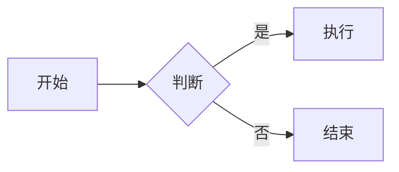
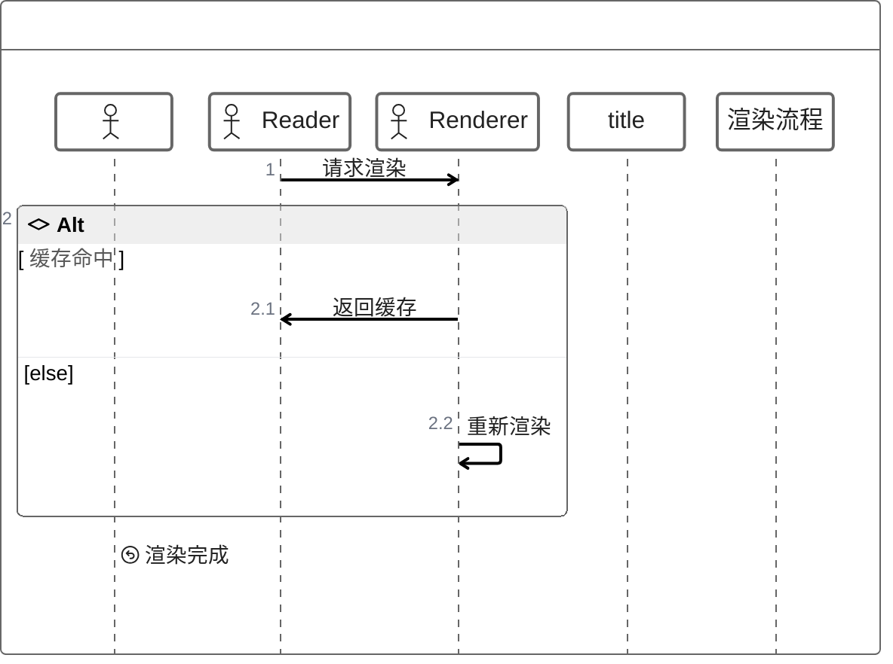

# Markdown 语法全集测试样例

> 用途：覆盖 CommonMark + GFM + Markable 扩展的**标准测试样例**，逐节核对渲染结果。
> 用法：用 Markable 打开本文件，从第 1 节往下逐项对照；每节的"期望"写在紧跟的 HTML 注释里（注释本身不显示）。
> 约定：☐ = 待勾选；"扩展"= Markable 特有语法，其他 Markdown 工具可能不识别。

---

## 1. 标题（ATX）

# 一级标题

## 二级标题

### 三级标题

#### 四级标题

##### 五级标题

###### 六级标题

<!-- 期望：h1–h6 字号依次递减；侧栏「大纲」出现 6 项，层级正确 -->

## 2. 标题（Setext）

Setext 一级标题
================

Setext 二级标题
----------------

<!-- 期望：等号行 → 一级标题，短横线行 → 二级标题（Setext 已支持；下划线行不显示） -->

## 3. 段落、换行与分隔

这是第一段。

这是第二段，行尾用两个空格制造硬换行：  
这一行应另起一行，但视觉上仍属于同一段。

反斜杠也能强制换行：\
这一行同样另起一行。

HTML 的 `<br>` 换行：<br>下一行。

空行分隔两个段落；
单个换行
在大多数渲染器里会合并成同一段。

<!-- 期望：两空格 / 反斜杠 / <br> 各自产生换行；空行才是新段落 -->

## 4. 强调与行内样式

*斜体（星号）*、_斜体（下划线）_、**粗体**、__粗体__、***粗斜体***、~~删除线~~、==高亮==、`行内代码`、~下标~、^上标^。

<!-- 期望：星号/下划线斜体、粗体、粗斜体（***x***）、删除线均正常；==高亮==、~下标~、^上标^ 为 Markable 扩展 -->

## 5. 链接

- 行内链接：[Markable 仓库](https://example.com/markable)
- 带标题的链接：[悬停提示](https://example.com "链接标题")
- 引用式链接：[引用链接][ref]
- 自动链接：<https://example.com>
- 邮箱：<mailto:hello@example.com>
- 锚点链接：[跳到第 1 节](#1-标题atx)
- 带查询参数的链接：<https://example.com/path?q=1&x=2>

[ref]: https://example.com/reference "引用式链接标题"

<!-- 期望：全部可点击；引用式链接定义行不显示；自动链接去掉尖括号并变成链接；锚点跳到第 1 节 -->

## 6. 图片

### 6.1 本地图片


### 6.2 带标题的图片


### 6.3 空 alt 图片


### 6.4 远程图片（不联网 → 占位）


### 6.5 缺失图片（占位）


### 6.6 引用式图片

![引用式图片][imgref]

[imgref]: demo.jpg "引用式图片"

### 6.7 裸 URL（自动链接）

https://www.deepseek.com/favicon.ico

<!-- 期望：本地图片显示（超宽等比缩到 640pt 内）；带标题 / 空 alt / 引用式图片都能正常显示；
     远程图片（DeepSeek 鲸鱼 logo：https://www.deepseek.com/favicon.ico）与缺失图片显示浅灰占位块（不联网）；裸 URL 变成可点击链接 -->

## 7. 列表

### 7.1 无序列表

- 苹果
- 香蕉
  - 香蕉的嵌套项
  - 另一个嵌套项
- 橙子

* 星号列表项
+ 加号列表项

### 7.2 有序列表

1. 第一步
2. 第二步
   1. 嵌套步骤 2.1
   2. 嵌套步骤 2.2
3. 第三步

### 7.3 起始编号

3. 从 3 开始
4. 接着 4
5. 接着 5

### 7.4 任务列表

- [ ] 未完成任务
- [x] 已完成任务
  - [x] 嵌套已完成
  - [ ] 嵌套未完成

### 7.5 列表里的多段内容

1. 第一段

   这是列表项里的第二段（缩进 4 空格）。

2. 第二段

   ```swift
   let nested = "列表中的代码块"
   ```

<!-- 期望：嵌套缩进正确；任务列表显示勾选框；有序列表保留起始编号；列表内代码块正常 -->

## 8. 引用

> 一级引用。
>
> > 嵌套引用。
> >
> > > 三级引用。

> 引用里的列表：
>
> - 项目一
> - 项目二
>
> 引用里的行内代码：`inline code`

<!-- 期望：整块灰底（NSTextBlock）+ 左侧竖线区分引用范围；空引用行 `>` 与嵌套层的内层 `>` 均隐藏（已支持）；引用内列表与代码正常 -->

## 9. 代码

### 9.1 围栏代码（带语言高亮）

```swift
struct Greeting {
    let name: String
    func hello() -> String { "你好，\(name)" }
}
```

```python
def hello(name: str) -> str:
    return f"你好，{name}"
```

### 9.2 围栏代码（无语言）

```
普通代码块
第二行
```

### 9.3 波浪线围栏

~~~
用三个波浪线包裹的代码块
~~~

### 9.4 缩进代码块

    这是缩进四个空格的代码块
    第二行

### 9.5 行内代码

调用 `print("hello")` 输出到控制台。

<!-- 期望：代码块等宽字体 + 语法高亮；缩进代码块生效；行内代码有底色 -->

### 9.6 中英文等宽（字体专项，覆盖各类对齐场景）

<!-- 期望：以下各分类里，1 个中文 = 2 个西文宽；中文行、西文行、中英混排行
     首尾严格对齐，缩进与列对齐不被中文字符破坏 -->

**分类 1：纯西文基线（等宽字体的对照基准）**

```text
abcdefghij
klmnopqrst
0123456789
```

**分类 2：纯中文（每个中文 = 2 个西文宽）**

```text
中文对齐测试
一二三四五六
排版验证样例
```

**分类 3：中英混排（同一行内 2:1 比例）**

```text
中文 ab
ab 中文
中a文b
```

**分类 4：缩进层级（2 空格 = 1 西文 = 半个中文）**

```text
顶层代码
  第二层
    第三层
      第四层
```

**分类 5：全角标点（，。；：！？ 也是 2 个西文宽）**

```text
，。；：！？
，。 ab
中文，标点。
```

**分类 6：代码注释中英混排（真实场景）**

```swift
// 中文注释与英文代码混排
let greeting = "你好，Markable"   // 中文值
let count = 42                    // 西文值
func render() {}                  // 函数
```

**分类 7：列对齐（用中英文拼的表格化文本）**

```text
名称    类型    状态
解析器  核心    完成
渲染器  核心    完成
导出    扩展    进行中
```

**分类 8：行内代码与正文混排**

`中文`、`latin`、`中文abc中文` 在同一行内保持 2:1 比例。

<!-- 校验方法：截图放大后比较每行首尾；分类 1 与分类 2 应等宽，
     分类 3 中「中文 ab」与「ab 中文」应等长 -->

## 10. 表格

### 10.1 基础表格

| 姓名 | 职责 | 入职年份 |
|---|---|---|
| 示例用户 | 维护者 | 2026 |
| 张三 | 贡献者 | 2025 |

### 10.2 对齐方式（左 / 中 / 右）

| 左对齐 | 居中 | 右对齐 |
| :--- | :---: | ---: |
| 左 | 中 | 右 |
| left | center | right |
| 123 | 456 | 789 |

### 10.3 单元格内联样式

| 样式 | 示例 | 说明 |
|---|---|---|
| 粗体 | **重要** | 用 `**` 包裹 |
| 行内代码 | `swift build` | 反引号 |
| 链接 | [DeepSeek](https://www.deepseek.com/) | 行内链接 |
| 删除线 | ~~已废弃~~ | 双波浪线 |
| 高亮 | ==重点== | Markable 扩展 |

### 10.4 多行内容与长文本

| 项目 | 内容 | 备注 |
|---|---|---|
| 换行 | 第一行<br>第二行<br>第三行 | 用 `<br>` 强制换行 |
| 长文本 | 这是一段较长的说明文字，用来测试单元格自动折行与列宽分配是否合理 | 自动折行 |
| 管道转义 | 管道转义 \| 竖线 | `\|` 是字面竖线 |

### 10.5 空单元格与缺列

| 列 A | 列 B | 列 C |
|---|---|---|
| 有值 |  | 有值 |
|  | 只有中间 |  |
| 短 | 短 | 短 |

### 10.6 单列表格

| 只有一列 |
|---|
| 甲 |
| 乙 |
| 丙 |

### 10.7 多列表格（6 列）

| 编号 | 名称 | 类型 | 状态 | 负责人 | 备注 |
|---:|---|---|---|---|---|
| 1 | 解析器 | 核心 | 完成 | 示例用户 | — |
| 2 | 渲染器 | 核心 | 完成 | 示例用户 | TextKit 1 |
| 3 | 导出 | 扩展 | 进行中 | — | PDF / HTML |

### 10.8 表格与代码块混排

| 命令 | 作用 |
|---|---|
| `swift build` | 编译 |
| `swift test` | 测试 |

```swift
let table = "代码块紧随表格"
```

### 10.9 宽表格（内容长 → 列宽自适应）

| 检查项 | 预期 | 实际 | 结论 |
|---|---|---|---|
| 列宽自适应 | 内容长的列更宽 | 第一列明显更宽 | 通过 |
| 单元格换行 | 长文本自动折行 | 折行正常 | 通过 |
| 表格总宽 | 不超出内容区 | 未溢出 | 通过 |

<!-- 期望：表头灰底；左/中/右对齐正确；单元格内联样式（粗体/代码/链接/删除线/高亮）生效；
     长内容列按内容自适应加宽；空单元格保留边框；单列/6 列表格均正常；表格总宽不超内容区 -->

## 11. 水平分隔线

三个短横线：

---

三个星号：

***

三个下划线：

___

<!-- 期望：三条横贯内容区的灰色水平线（不是字面的 --- / *** / ___） -->

## 12. 脚注

这里引用一个脚注[^1]，再引用第二个[^note]。

[^1]: 脚注一的内容。
[^note]: 脚注二的内容，带 **粗体**。

<!-- 期望：正文出现上标序号；文末生成脚注区；点击可跳转。
     实测（2026-10-24）：上标序号与文末脚注区正常；脚注内容里的 `**粗体**` 按原文显示（已知差异） -->

## 13. HTML

行内 HTML：<strong>加粗</strong>、<em>斜体</em>、<u>下划线</u>、<mark>标记</mark>。

块级 HTML：

<div style="padding: 8px; background: #f5f5f7; border-radius: 6px;">
  这是一个 HTML 块。
</div>

<details>
<summary>折叠面板（点开）</summary>

隐藏内容。

</details>

<!-- 期望：标记按原样显示或降级（阅读器不执行脚本）；<details> 可能不折叠，属已知差异 -->

## 14. 数学

行内公式：$E = mc^2$，以及 $\frac{a}{b}$。

块级公式：

$$
\int_{-\infty}^{\infty} e^{-x^2}\,dx = \sqrt{\pi}
$$

<!-- 期望：KaTeX 渲染；行内公式与正文基线对齐，块级公式居中 -->

## 15. Mermaid 图




```mermaid
venn
  "渲染": 10
  "导出": 8
```



```mermaid
requirement
  requirement 阅读器 {
    id: 1
    text: 打开 Markdown 并渲染
    risk: medium
  }
  requirement 导出器 {
    id: 2
    text: 导出 A4 PDF
    risk: low
  }
  阅读器 - satisfies -> 导出器
```


<!-- 期望：流程图 / 看板 / 矩形树图 / 集合图 / 时序风格（含 if-else 控制块、@Actor、title、%%{init}%% 配置容忍）/ 需求图 / 事件建模均渲染为图片；解析失败时显示原因提示并保留代码块 -->
<!-- 自研渲染器：gantt / mindmap / timeline / xychart / quadrantchart / packet / sankey / block / kanban / treemap / venn / zenuml / requirement / eventmodeling；Vendor：flowchart / sequence / pie / class / state / er / gitGraph / journey / architecture -->

## 16. 目录（扩展）

{{TOC}}

<!-- 期望：在当前位置生成层级目录，条目可点击跳转 -->

## 17. 分页（扩展）

第一页内容。

===

第二页内容。

+++

第三页内容。

<!-- 期望：=== 与 +++ 渲染成 ─ 分隔线（Markable 的文档内分页标记） -->

## 18. 转义与实体

转义字符：\*不是斜体\*、\_不是下划线\_、\`不是代码\`、\\ 反斜杠、\# 井号。

HTML 实体：&amp; &lt; &gt; &quot; &apos; &copy; &nbsp;空格 &#x2F; &#169;

<!-- 期望：转义后按字面显示（去掉反斜杠、不触发强调）；HTML 实体解码为 & < > " ' © 等（已支持） -->

## 19. 混合与边界

### 19.1 引用中的表格

> | 引用内 | 表格 |
> |---|---|
> | a | b |

### 19.2 列表中的引用

- 列表项：
  > 列表里的引用

### 19.3 表格与代码

| 命令 | 说明 |
|---|---|
| `swift build` | 编译 |
| `swift test` | 测试 |

### 19.4 紧贴的强调

**粗体紧贴中文**、**粗体后跟英文**word、`代码贴中文`字。

### 19.5 空元素

这是一个空链接 []()，一个空图片 。

<!-- 期望：边界情况不崩溃；空链接/空图片给占位或直接不显示。
     实测（2026-10-24）：按原文显示 `[]()` / ``（已知差异） -->

## 20. 已知不支持与降级差异（对照用）

以下语法不在 Markable 的渲染范围内，或与 CommonMark/GFM 有差异，预期原样显示、降级或保留标记：

**不支持**

- 定义列表（CommonMark 本就不支持）：

  ```
  术语
  : 定义
  ```

- 属性语法：`# 标题 {#id .class}`
- `<script>` 等可执行 HTML（阅读器不执行脚本）

**降级 / 标记保留（2026-10-24）**

- 任务列表：默认显示为 `- ☐` / `- ☑`（设置里可开启项目符号，开启后短横线隐藏）
- 无序列表：默认 `-` / `*` / `+` 标记保留；设置「无序列表显示项目符号」开启后渲染为 `•`（嵌套缩进照常）
- 引用块内的列表：列表短横线保留（引用前缀已隐藏）
- 脚注：文末脚注区正常，但脚注内容里的 `**粗体**` 按原文显示
- 空链接 / 空图片：`[]()`、`` 按原文显示
- 行内 HTML 标签（`<strong>` 等）：按原文显示
- 数学公式：KaTeX **异步渲染**——首屏显示占位符 `⋯`，渲染完成后替换为公式（导出/快照时机不同会看到差异）

**已经支持（2026-10-24 补齐）**

- 反斜杠转义（`\*` → `*`，且不触发强调）
- HTML 实体（命名 + 数字，`&amp;` → `&`、`&#169;` → ©）
- 引用块的空行 `>` 与嵌套层 `> >`（标记全部隐藏）
- 表格单元格内的 `\|`（字面竖线，不产生多余列）
- Setext 标题（`标题` + `===` / `---`），且不与水平线混淆
- 粗斜体 `***x***`（同时加粗与倾斜，不残留星号）
- 自动链接 `<https://…>`（去掉尖括号，生成可点击链接）
- 引用式链接的定义行（`[ref]: url`）不再出现在正文
- 图片 title（``）与空 alt 图片（``）
- 引用式图片（`![alt][ref]` + `[ref]: path "title"`）
- 裸 URL 自动链接（`https://…` 直接可点击）
- 删除线 `~~x~~`
- 行内 `<br>` 换行（普通文本与表格单元格均支持；反引号内的 `<br>` 保持字面）
- 引用块整块灰底（NSTextBlock）+ 左侧竖线（`>` 前缀隐藏；灰底覆盖整段，不再是字符背景）
- 空行分隔的多段引用：每段首行都有左侧竖线（2026-10-24 修复）
- 引用块内的围栏代码块（引用前缀 + 三反引号）：围栏隐藏、内容等宽 + 灰底，竖线与整块灰底保留（2026-10-24 补齐）
- 列表项目符号开关（设置 → 排版）：无序列表 `-` → `•`，任务列表去掉短横线
- Mermaid：全部已知类型均有渲染器（自研 + Vendor）；解析失败时显示「渲染失败，已回退源码」
- 数学公式先占位后替换（`⋯` → KaTeX 图片），不再闪现源码
- 表格列对齐（`:---` / `:---:` / `---:` → 左 / 中 / 右）
- 表格列宽按内容自适应（长内容列更宽，总宽不超内容区）

<!-- 期望：未知语法按普通文本显示，不崩溃、不隐藏正文 -->

---

## 附：核对清单

| 元素 | 是否正常 | 备注 |
|---|---|---|
| 标题 h1–h6 | ☑ | |
| Setext 标题 | ☑ | 已支持 |
| 换行（两空格 / 反斜杠 / br） | ☑ | |
| 强调与扩展样式 | ☑ | 含粗斜体 |
| 链接（行内 / 引用 / 自动 / 锚点） | ☑ | 引用式定义行已隐藏 |
| 图片（本地 / 带标题 / 空 alt / 引用式 / 远程占位） | ☑ | 本地图片为 samples/demo.jpg |
| 列表（无序 / 有序 / 嵌套 / 任务） | ☑ | 默认保留标记；设置可切换项目符号 |
| 引用（嵌套 / 列表 / 表格） | ☑ | 整块灰底 + 左侧竖线；空行/嵌套标记已隐藏；引用内围栏代码块已支持；引用内表格降级 |
| 代码（围栏 / 缩进 / 行内 / 高亮） | ☑ | |
| 代码字体中英等宽（8 类场景） | ☑ | 见 9.6：纯西文 / 纯中文 / 混排 / 缩进 / 全角标点 / 注释 / 列对齐 / 行内代码 |
| 表格（基础 / 对齐 / 内联 / 多行 / 空单元格 / 单列 / 6 列 / 混排 / 宽表自适应） | ☑ | `\|` 已支持；列宽按内容自适应 |
| 水平线 | ☑ | |
| 脚注 | ☑ | 脚注内联样式不渲染 |
| HTML | ☑ | 原样显示 / 降级 |
| 数学（行内 / 块级） | ☑ | 异步渲染；先占位 `⋯` 再替换 |
| Mermaid | ☑ | 全部已知类型已支持（含 kanban / treemap / venn / zenuml / requirement / eventmodeling）；失败回退源码 |
| 目录 {{TOC}} | ☑ | |
| 分页 === / +++ | ☑ | |
| 转义与实体 | ☑ | 已支持 |

---

> 版本：1.0（2026-10-24）
> 维护：新增语法元素时同步更新第 20 节与核对清单。
